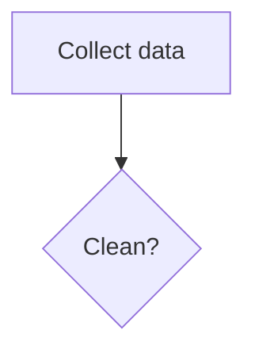

# The Naiad file format

For anyone, person or AI agent, who edits a Naiad file by hand. A Naiad file is an
ordinary Mermaid flowchart saved as `.mmd` (or `.mermaid`), or a Markdown file (`.md`)
with the flowchart in a `mermaid` block
([A flowchart inside a Markdown file](#a-flowchart-inside-a-markdown-file)). It opens
unchanged in every Mermaid tool. Naiad adds one convention on top: **description
blocks**, written as Mermaid comments, which hold each node's full description.

The text file is the only copy of the flowchart. Naiad keeps no other data about it: no
positions, no second copy. The one file Naiad may write beside it holds highlights, which
are not part of the flowchart and are deleted when Naiad stops showing it
([Highlights](#highlights)).

## A whole file


## Titles

A node's **title** is its Mermaid label: `collect[Collect data]` has the id `collect` and
the title `Collect data`. The chart shows only the title. A node with no label
(`collect`) shows its id.

Keep titles short; put everything else in the description.

A title that holds parentheses, brackets, braces or a double quote is written in double
quotes, in any shape: `id["Title with (punctuation)"]`, `id{"Sure (really)?"}`. Other
punctuation needs no quotes.

The word `end` in lower case cannot be a node's id: Mermaid reads it as the end of a
group.

## Description blocks

A node's **description** is the text shown under its title in the sidebar when the node
is clicked. It is Markdown.

```
%% @<node id>
%% <first line of the description>
%% <next line>
```

Rules:

1. The block starts with a line holding only `%% @` and the node's id, exactly as the id
   is written in the flowchart (`%% @collect`).
2. Every following line that starts with `%%` belongs to the description. One space
   after `%%` is dropped; the rest of the line is the text. The sidebar shows each
   line as a line of its own, so a paragraph is written as one line, however long.
3. The block ends at the first line that is not a `%%` comment (an empty line ends it),
   or at the next `%% @id` line.
4. **An empty line inside a description is written `%% .`** (two percent signs, a space,
   a full stop). Never write a line holding only `%%`: Mermaid 12 does not read a bare
   `%%` as a comment; it reads it as a node named `%%`. Naiad tolerates a bare `%%` when
   it reads a file, warns about it, and offers a one-click fix.
5. A description line whose whole text is `.` or `@something` is written with a
   backslash in front (`%% \.`, `%% \@something`), so it is not taken for an empty line
   or for the start of another block.
6. A block may sit anywhere a comment may: on its own lines, at any indent. Naiad adds
   new blocks at the end of the file, after one empty line.
7. If two blocks name the same id, the first one is used.
8. A block whose id matches no node is kept as it is and shown nowhere.
9. A `%%` comment that follows no `%% @id` line is an ordinary comment; Naiad leaves it
   alone. `%%{ ... }%%` directives are not description lines.

A comment must be on a line of its own. Mermaid 12 rejects a comment after a statement
on the same line (`a --> b %% note` is a syntax error).

## A flowchart inside a Markdown file

Naiad also opens a Markdown file (`.md`, `.markdown`) and works on a flowchart kept in
it as a fenced block marked `mermaid`, the form GitHub and most Markdown tools draw in
place. This guide calls it the **flowchart block**:

````markdown
# Pipeline

Some text.



More text.
````

- Everything said above holds inside the flowchart block: titles, description blocks,
  `%% .`. Description blocks go inside the flowchart block, before its closing line, so
  it stays one valid Mermaid flowchart and still draws on GitHub.
- Naiad changes only lines between the flowchart block's opening and closing lines.
  Every other line of the Markdown file stays byte for byte as it was. Before saving,
  Naiad reads its own result back and refuses to save if the flowchart block would no
  longer be found whole.
- The text pane shows the flowchart's text, not the Markdown around it.
- A flowchart block is opened with three or more backticks or tildes followed by
  `mermaid`, and closed by a line of the same character, at least as many of them.
  Fenced blocks in other languages, and `mermaid` blocks that are not flowcharts (their
  first line is not `flowchart` or `graph`), are left alone. A flowchart block inside a
  quote (`>`) is not found, nor is a fence inside YAML front matter at the top of the
  file (from a first line of `---` to the next `---` or `...`).
- A file with several flowchart blocks shows one at a time; a list in the toolbar
  switches between them.
- A flowchart block may be indented, for example inside a list. Every line of it must
  then start with the same whitespace as its opening line (empty lines may be fully
  empty, or all carry that whitespace). If they do not, or the closing line is missing,
  Naiad shows the flowchart but does not change it.
- A line that would close the flowchart block (three or more backticks alone on a line,
  when it was opened with backticks) cannot be part of a flowchart in a Markdown file.
  Naiad does not save such a text.

## What Naiad changes in a file, and what it never does

- An edit made in the chart or the sidebar changes only the lines that edit needs. Every
  other line, its spacing and its comments stay byte for byte as they were.
- Every line keeps its own line ending (LF, CRLF or a lone CR), so a file that mixes
  them stays mixed. A line Naiad changes keeps the ending it had; a line it adds takes
  the ending of the line above it. A byte-order mark is kept.
- Before an edit is applied, Naiad asks Mermaid's own parser what the flowchart means
  before and after. If the result does not parse, or differs from the edit that was
  asked for, the edit is refused and the file is not touched.
- A line Naiad's scanner cannot read is left alone, and chart edits are refused (with a
  message naming the line) until it is fixed in the text pane. Typing in the text pane
  always works.
- The file is saved only while it is a valid Mermaid flowchart (Ctrl+S saves it anyway).
- When the file changes on disk (an agent or another editor saved it), Naiad reloads
  it. If Naiad holds an unsaved edit at that moment, the version on disk wins and the
  unsaved edit stays in Undo. In a Markdown file, a change on disk that leaves the
  flowchart block as it was (only the text around it changed) is taken in without
  touching the flowchart or an unsaved edit to it. If Naiad cannot tell for certain
  which flowchart block it was showing (the block was removed, or it changed while
  other Mermaid blocks were added, removed or changed), it changes nothing more in the
  file until the file is opened again.
- The checker's `fix` changes one thing only: a line holding nothing but `%%` becomes
  `%% .`, in place. It asks Mermaid's parser what the flowchart means before and after,
  and changes nothing when Mermaid cannot read the flowchart, when the meaning or a
  description would differ, or when the file changed while it was being checked. The
  checker's `check` never writes.
- Highlighting never touches the flowchart's file: highlights have a file of their own
  ([Highlights](#highlights)).
- All of this holds in Naiad's window and in the page that `naiad serve <file>` shows
  in a browser: they are the same program and follow the same rules.

## Highlights

A highlight marks a node, an arrow or a group for the person and an agent to point at:
several at once, shown in Naiad's window and in every page `naiad serve` shows of the
same file. Highlights are not part of the flowchart. They are kept in a small file of
their own, for `flow.mmd`:

```
.naiad/flow.mmd/highlights.txt
```

that is, a folder named `.naiad` in the flowchart's folder, and in it a folder named
exactly as the flowchart's file, its ending included. One item per line:

```
# working on the cleaning step
collect
clean
collect --> clean
```

- An item is a node's or a group's id, or an arrow written as its two ends,
  `from --> to` (the first arrow with those ends).
- Blank lines and lines starting with `#` are ignored, and so is a line that names
  nothing on the chart. In a Markdown file the items apply to the flowchart shown.
- In Naiad, the **Highlight** switch in the toolbar (key H) makes a click on an item
  highlight it, or take its highlight off, instead of selecting it. **Clear** takes
  every highlight off.
- Anyone may write the file: Naiad shows a change to it within a second, and need not
  be running when it is written.
- When Naiad changes the list it writes the whole file, through a temporary file and a
  rename, and keeps every line it was not asked to change. When the last item is taken
  off it deletes the file, and the folders it leaves empty. When it makes the `.naiad`
  folder, or finds one, it sets Windows' hidden mark on it, as git does for `.git`.
- The file is deleted when the last Naiad view of the flowchart closes: its window, or
  the last page `naiad serve` shows of it (within half a minute of that page closing).
  Highlights written while no view was open, or left by a Naiad that was stopped by
  force, show at the next opening and go at the next closing.

## Mermaid syntax Naiad can edit from the chart

Reading: anything Mermaid's flowchart parser accepts is drawn.

Editing from the chart or sidebar works on these forms; lines in other forms are drawn
but must be edited as text:

- Header: `flowchart TD` or `graph LR` (directions TB, TD, BT, LR, RL).
- Nodes: `id`, `id[Title]`, `id["Title with (punctuation)"]`, and the shapes `(round)`,
  `([stadium])`, `[[subroutine]]`, `[(cylinder)]`, `((circle))`, `(((double circle)))`,
  `{diamond}`, `{{hexagon}}`, `[/lean right/]`, `[\lean left\]`, `[/trapezoid\]`,
  `[\inverted trapezoid/]`, `>flag]`, `(-ellipse-)`.
- Links: `-->`, `---`, `-.->`, `==>`, `<-->`, `--o`, `--x`, with a label as
  `-->|label|` or `-- label -->`; chains (`a --> b --> c`) and `&` lists
  (`a & b --> c`).
- Groups: `subgraph id [Title]` ... `end`, with an optional `direction LR` line inside.
- Styling: `style id fill:#...,stroke:#...,color:#...`.
- Inside a quoted title, a double quote is written `#quot;`.

## Checking a file from a terminal

Where Naiad is installed, a terminal can check a file without opening a window:

```
naiad check flow.mmd
naiad fix flow.mmd
```

- `naiad check` prints each place a file breaks this format, with its line number and
  how to put it right, and ends each file with the number of its problems, or
  `no problems`. It reads `.mmd`, `.mermaid` and every flowchart block of a `.md` or
  `.markdown` file, and takes several files at once. Its exit code is 0
  when there are no problems, 1 when there are, and 2 when a file could not be checked.
- It reports: text Mermaid's flowchart parser rejects; a line holding nothing but `%%`;
  a comment after a statement on the same line; a description block whose id matches
  no node or group; a second description block for one id; a line Naiad's scanner
  cannot read. It reports nothing about style.
- `naiad fix` first puts right what cannot change the flowchart (see "What Naiad
  changes in a file"), then checks.
- On Windows the installer adds the `naiad` command to the user's PATH. A terminal that
  was open during the install does not know the command yet: open a new one, or run it
  by its full path, by default `%LOCALAPPDATA%\Naiad\bin\naiad.exe`.

## Advice for an agent editing a file

- After changing a file, run `naiad check` on it where Naiad is installed, and put
  right what it reports.
- Change only the lines your edit needs; do not reformat or reorder the rest.
- Give every node a short, stable id (letters, digits, `_`); the id ties a node to its
  description block. If you rename an id, rename its `%% @id` line too.
- Put long text in a description block, never in the title.
- Write each paragraph of a description as one line; do not wrap it.
- Write an empty description line as `%% .`.
- In a Markdown file, keep description blocks inside the flowchart block, and keep
  every line of an indented flowchart block at its indent.
- Naiad reloads the file as soon as you save it; nothing else needs doing.
- To point the user at items, highlight them in the highlights file
  ([Highlights](#highlights)), never by changing the flowchart.
