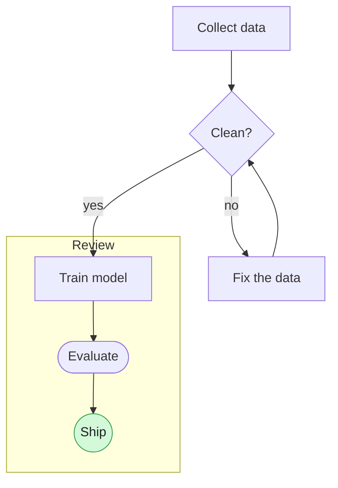

# The Naiad file format

For anyone, person or AI agent, who edits a Naiad file by hand. A Naiad file is an
ordinary Mermaid flowchart saved as `.mmd` (or `.mermaid`). It opens unchanged in every
Mermaid tool. Naiad adds one convention on top: **description blocks**, written as
Mermaid comments, which hold each node's full description.

The text file is the only copy of the flowchart. Naiad keeps no other data: no positions,
no hidden file beside it.

## A whole file



## Titles

A node's **title** is its Mermaid label: `collect[Collect data]` has the id `collect` and
the title `Collect data`. The chart shows only the title. A node with no label
(`collect`) shows its id.

Keep titles short; put everything else in the description.

## Description blocks

A node's **description** is the text shown under its title in the sidebar when the node
is clicked. It is Markdown.

```
%% @<node id>
%% <first line of the description>
%% <next line>
```

Rules:

1. The block starts with a line holding only `%% @` and the node's id, exactly as the id
   is written in the flowchart (`%% @collect`).
2. Every following line that starts with `%%` belongs to the description. One space
   after `%%` is dropped; the rest of the line is the text.
3. The block ends at the first line that is not a `%%` comment (an empty line ends it),
   or at the next `%% @id` line.
4. **An empty line inside a description is written `%% .`** (two percent signs, a space,
   a full stop). Never write a line holding only `%%`: Mermaid 12 does not read a bare
   `%%` as a comment; it reads it as a node named `%%`. Naiad tolerates a bare `%%` when
   it reads a file, warns about it, and offers a one-click fix.
5. A description line whose whole text is `.` or `@something` is written with a
   backslash in front (`%% \.`, `%% \@something`), so it is not taken for an empty line
   or for the start of another block.
6. A block may sit anywhere a comment may: on its own lines, at any indent. Naiad adds
   new blocks at the end of the file, after one empty line.
7. If two blocks name the same id, the first one is used.
8. A block whose id matches no node is kept as it is and shown nowhere.
9. A `%%` comment that follows no `%% @id` line is an ordinary comment; Naiad leaves it
   alone. `%%{ ... }%%` directives are not description lines.

A comment must be on a line of its own. Mermaid 12 rejects a comment after a statement
on the same line (`a --> b %% note` is a syntax error).

## What Naiad changes in a file, and what it never does

- An edit made in the chart or the sidebar changes only the lines that edit needs. Every
  other line, its spacing and its comments stay byte for byte as they were. Line endings
  (LF or CRLF) and a byte-order mark are kept as found.
- Before an edit is applied, Naiad asks Mermaid's own parser what the flowchart means
  before and after. If the result does not parse, or differs from the edit that was
  asked for, the edit is refused and the file is not touched.
- A line Naiad's scanner cannot read is left alone, and chart edits are refused (with a
  message naming the line) until it is fixed in the text pane. Typing in the text pane
  always works.
- The file is saved only while it is a valid Mermaid flowchart (Ctrl+S saves it anyway).
- When the file changes on disk (an agent or another editor saved it), Naiad reloads
  it. If Naiad holds an unsaved edit at that moment, the version on disk wins and the
  unsaved edit stays in Undo.

## Mermaid syntax Naiad can edit from the chart

Reading: anything Mermaid's flowchart parser accepts is drawn.

Editing from the chart or sidebar works on these forms; lines in other forms are drawn
but must be edited as text:

- Header: `flowchart TD` or `graph LR` (directions TB, TD, BT, LR, RL).
- Nodes: `id`, `id[Title]`, `id["Title with (punctuation)"]`, and the shapes `(round)`,
  `([stadium])`, `[[subroutine]]`, `[(cylinder)]`, `((circle))`, `(((double circle)))`,
  `{diamond}`, `{{hexagon}}`, `[/lean right/]`, `[\lean left\]`, `[/trapezoid\]`,
  `[\inverted trapezoid/]`, `>flag]`, `(-ellipse-)`.
- Links: `-->`, `---`, `-.->`, `==>`, `<-->`, `--o`, `--x`, with a label as
  `-->|label|` or `-- label -->`; chains (`a --> b --> c`) and `&` lists
  (`a & b --> c`).
- Groups: `subgraph id [Title]` ... `end`, with an optional `direction LR` line inside.
- Styling: `style id fill:#...,stroke:#...,color:#...`.
- Inside a quoted title, a double quote is written `#quot;`.

## Advice for an agent editing a file

- Change only the lines your edit needs; do not reformat or reorder the rest.
- Give every node a short, stable id (letters, digits, `_`); the id ties a node to its
  description block. If you rename an id, rename its `%% @id` line too.
- Put long text in a description block, never in the title.
- Write an empty description line as `%% .`.
- Naiad reloads the file as soon as you save it; nothing else needs doing.
