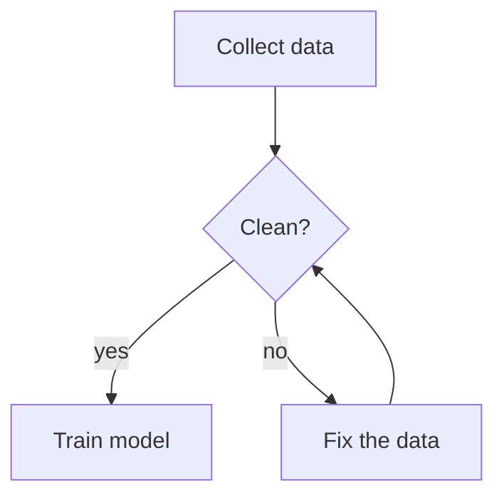

# Naiad

A lightweight flowchart viewer and editor for plain Mermaid text files.

- The flowchart is one ordinary `.mmd` file, or a `mermaid` block inside a Markdown
  file (`.md`), where Naiad touches nothing but the block. It is valid Mermaid, opens in
  any Mermaid tool, and is the only copy: no positions, no hidden data.
- On the chart each node shows only a short **title**. Click a node and a **sidebar**
  opens with its title and its full **description** (Markdown).
- Edit the file by hand, let an AI agent edit it, or edit in Naiad (on the chart, in the
  sidebar, or in the text pane). Naiad reloads the file whenever it changes on disk.
- Naiad never rewrites the file wholesale: an edit changes only the lines it needs, and
  every edit is checked against Mermaid's own parser before it is applied.



The description of a node is a block of Mermaid comments that starts with `%% @` and the
node's id. The full rules, for people and for agents: [FILE-FORMAT.md](FILE-FORMAT.md).

## Using it

| To | Do |
|---|---|
| Read a description | Click a node |
| Add a node | **+ Node**, or double-click empty space |
| Rename | Double-click a node, or press Enter / F2 |
| Connect two nodes | Drag from the dot on a selected node to another node, or Shift-click the second node |
| Change an arrow | Click it: label, line, head |
| Group nodes | Select a node, then **Group** in the sidebar |
| Delete | Select, then Delete |
| Undo / redo | Ctrl+Z / Ctrl+Y |
| Zoom / pan | Mouse wheel / drag empty space |

The file is saved by itself while it is a valid flowchart; Ctrl+S saves it at once.

## From a terminal

The Windows installer adds a `naiad` command (open a new terminal after installing):

```bash
naiad flow.mmd          # open the file in Naiad
naiad check flow.mmd    # report where the file breaks the format; no window opens
naiad fix flow.mmd      # put right what cannot change the flowchart, then check
```

`naiad check` is made for agents and scripts: it prints each problem with its line and
how to put it right, and its exit code is 0 only when there are none. Details:
[FILE-FORMAT.md](FILE-FORMAT.md), "Checking a file from a terminal".

## For AI agents

The folder [skills/naiad](skills/naiad) is a skill: instructions an agent loads when a
task calls for a flowchart. It teaches the agent the file format, has it check its work
with `naiad check`, and has it open the file in Naiad for you to see.

Install it with the [skills](https://github.com/vercel-labs/skills) installer, which
knows where each agent tool keeps its skills:

```bash
npx skills add Cleo8731/naiad
```

Or copy the folder `skills/naiad` by hand: for Claude Code, to `~/.claude/skills/naiad`
(every project on your computer) or to `.claude/skills/naiad` inside a project (commit
it and everyone working on the project has it).

### Keeping flowcharts up to date (optional)

A flowchart that describes a project goes stale when the project changes. To have
agents keep it true, add this section to the project's instruction file (`CLAUDE.md`,
`AGENTS.md` or its like), with one line for each flowchart:

```
## Naiad flowcharts
Keep these flowcharts true: when a change alters what one shows, update it in
the same change, following the naiad skill, and say so in your report.
- `docs/architecture.mmd`: the import pipeline
- `docs/release.mmd`: the release steps
```

The skill offers to add this for you when an agent creates a flowchart of the project.

## Building from source

Needs [Node.js](https://nodejs.org), [Rust](https://rustup.rs) and, on Windows, the
Visual Studio C++ Build Tools (see the [Tauri prerequisites](https://tauri.app/start/prerequisites/)).

```bash
npm install
npm run tauri dev      # run the desktop app
npm run tauri build    # build the app and its installer
npm test               # run the tests
```

`npm run dev` runs Naiad in a browser against `examples/sample.mmd`, without the desktop
shell.

Built with [Tauri](https://tauri.app) and [Mermaid](https://mermaid.js.org).

## Licence

[MIT](LICENSE).
