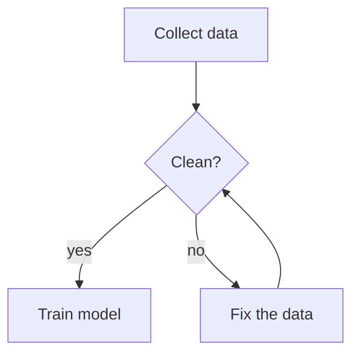

# Naiad

Naiad is a Windows desktop app that shows and changes a flowchart kept in one plain
Mermaid text file, for one person and the AI agents that work on the same file.

The chart shows each node's short title. Click a node and the sidebar shows its full
description, which the file keeps beside the node as Mermaid comments. With nothing
selected, the sidebar shows a description of the whole flowchart, kept the same way. In other Mermaid
tools a node holds only its label, so detail either crowds the chart or lives in a
second document. With Naiad the file stays the only copy, opens in any Mermaid tool, and
you, an agent or Naiad can change it.

The example below is made up. GitHub draws the chart; the lines starting `%%` are a
description, which Mermaid leaves out and Naiad shows in the sidebar:



- The flowchart is one `.mmd` or `.mermaid` file.
- Naiad reloads the file whenever it changes on disk, so a change an agent makes shows
  at once.
- A change made in Naiad rewrites only the lines it needs, and Mermaid's own parser
  checks it before it is applied.

A description is a run of Mermaid comments that starts with `%% @` and the node's id;
the whole flowchart's description starts with `%% @flowchart`.
The full rules, for people and for agents: [FILE-FORMAT.md](FILE-FORMAT.md).

## Install

No installer is published yet. To use Naiad now, make the installer yourself
([Building from source](#building-from-source)) and run
`src-tauri/target/release/bundle/nsis/Naiad_0.3.0_x64-setup.exe` (2.8 MB). It installs
Naiad for your Windows user in `%LOCALAPPDATA%\Naiad`, registers it for `.mmd` and
`.mermaid` files, so a double-click on a `.mmd` file opens it, and adds the `naiad`
command to your PATH. Then open a file with **Open**, or start one with **New**.

## Using it

| To | Do |
|---|---|
| Read a description | Click a node |
| Read or write what the whole flowchart is about | Click empty space: the sidebar shows the flowchart's description, under any node, arrow or group you select. **About** hides or shows it, and Naiad remembers your choice |
| Add a node | **+ Node**, or double-click empty space |
| Rename | Double-click a node, or press Enter / F2 |
| Connect two nodes | Point at a node and drag the dot beside it to another node, or Shift-click the second node |
| Change an arrow | Click it: label, line, head, colour |
| See where a node's arrows go | Rest the pointer on the node: its arrows and the nodes at their other ends stay, and the rest fades |
| Move an arrow's start or end | Point at the arrow and drag the dot at that end onto another node or group; or pick it under **From** or **To** in the sidebar |
| Group nodes | Click a node and pick **New group…** under **Group** in the sidebar; then click each other node and pick that group there |
| Delete | Select, then Delete |
| Undo / redo | Ctrl+Z / Ctrl+Y |
| Zoom / pan | Mouse wheel / drag empty space |
| Point at nodes, arrows or groups with an agent | **Highlight** (key H), then click them; **Clear** takes every highlight off |
| Show or hide the flowchart's Mermaid syntax | **Syntax** (hidden when Naiad starts, unless you left it open) |
| Read without changing anything | **View**: no dots to drag, no dot grid, and the sidebar and the Syntax pane show text only; an edit tried there shows a notice instead. Press **View** again to edit. Naiad opens in the mode you left it in |

While you drag a dot, holding the pointer within 48 px of the chart's edge moves the
view that way, at up to 1,200 px a second, until the chart's edge on that side comes
into view; the mouse wheel zooms, and Escape cancels the drag.

The file is saved by itself while it is a valid flowchart; Ctrl+S saves it at once.
Highlights are kept in a small file of their own beside the flowchart, which an agent
reads and writes too ([FILE-FORMAT.md](FILE-FORMAT.md#highlights)).

## From a terminal

```bash
naiad flow.mmd          # open the file in Naiad
naiad check flow.mmd    # report where the file breaks the format; no window opens
naiad fix flow.mmd      # put right what cannot change the flowchart, then check
naiad serve flow.mmd    # show the file in a browser on this computer; prints the address
naiad --version
```

A terminal that was open during the install does not know the command yet: open a new
one.

`naiad check` is made for agents and scripts: it prints each problem with its line and
how to put it right, or `flow.mmd: no problems`. Its exit code is 0 when there are no
problems, 1 when there are, and 2 when a file could not be checked. Details:
[FILE-FORMAT.md](FILE-FORMAT.md), "Checking a file from a terminal".

`naiad serve` is for an agent whose tool has a browser beside the conversation: it
shows the flowchart there, where you can also change it, with no separate window. The
command prints an address (`http://127.0.0.1:` and a port) and returns. The page at
that address is Naiad itself and saves by the same rules; Naiad's own window can be
open on the same file at the same time. The server behind it can be reached from this
computer only, answers only at the address it printed (which holds a secret), refuses
requests that come from other web pages, reads and writes only the file it was started
for and that file's highlights, and ends by itself ten minutes after the page is closed.

## For AI agents

The folder [skills/naiad](skills/naiad) is a skill: instructions an agent loads when a
task calls for a flowchart. It teaches the agent the file format, has it check its work
with `naiad check`, and has it show you the result: in the browser beside the
conversation where the agent's tool has one, otherwise in Naiad's window.

The [skills](https://github.com/vercel-labs/skills) installer knows where each agent
tool keeps its skills. This command has not been tried with Naiad's skill yet:

```bash
npx skills add Cleo8731/naiad
```

Or copy the folder `skills/naiad` by hand: for Claude Code, to `~/.claude/skills/naiad`
(every project on your computer) or to `.claude/skills/naiad` inside a project (commit
it and everyone working on the project has it).

### Keeping flowcharts up to date (optional)

A flowchart that describes a project goes stale when the project changes. To have
agents keep it true, add this section to the project's instruction file (`CLAUDE.md`,
`AGENTS.md` or its like), with one line for each flowchart:

```
## Naiad flowcharts
Keep these flowcharts true: when a change alters what one shows, update it in
the same change, following the naiad skill, and say so in your report.
- `docs/architecture.mmd`: the import pipeline
- `docs/release.mmd`: the release steps
```

The skill offers to add this for you when an agent creates a flowchart of the project.

## What Naiad reads and keeps

- The file you open: read again whenever it changes on disk, and written only as
  [FILE-FORMAT.md](FILE-FORMAT.md#what-naiad-changes-in-a-file-and-what-it-never-does)
  describes.
- Highlights: `.naiad/<file name>/highlights.txt` in the flowchart's folder, with
  Windows' hidden mark on `.naiad`. The file, and the folders it leaves empty, are
  deleted when the last Naiad view of the flowchart closes.
- In your temporary folder, while they run: a small record of each open window
  (`naiad-views`), and the address of each `naiad serve` server (`naiad-serve`), so a
  second `naiad serve` on the same file prints the same address.
- Whether the Syntax pane is shown, its width, and whether **View** is on, in the
  window's own storage.
- Naiad makes no network requests of its own. An image in a description that points to
  a web address is loaded from there when the description is shown, and a link in a
  description opens in your browser.

## Limits

- Naiad 0.3.0 has been made and tested on Windows 11 (x64) only. There are no macOS or
  Linux builds.
- It works on Mermaid flowcharts only (text that starts `flowchart` or `graph`), in
  `.mmd` and `.mermaid` files. It does not open a Markdown file (`.md`), even one with a
  `mermaid` code block.
- Some Mermaid forms are drawn but can be changed only as text; the forms the chart
  can change are listed in
  [FILE-FORMAT.md](FILE-FORMAT.md#mermaid-syntax-naiad-can-edit-from-the-chart).
- Mermaid places the boxes. The file keeps no positions, so a node cannot be moved by
  hand.

## Building from source

Made and tested on Windows 11 with Node.js 26.7 (npm 11.19), Rust 1.99.1
(`stable-x86_64-pc-windows-msvc`) and the Visual Studio 2022 C++ Build Tools (see the
[Tauri prerequisites](https://tauri.app/start/prerequisites/)).

```bash
npm install
npm test               # run the tests
npm run dev            # Naiad in a browser, without the desktop window
npm run tauri build    # the desktop app and its installer, in src-tauri/target/release/
```

`npm run dev` opens `examples/sample.mmd`, or the file named by the `NAIAD_FILE`
environment variable, and saves changes to it.

Report a problem or ask for a change in the
[issues](https://github.com/Cleo8731/naiad/issues).

Built with [Tauri](https://tauri.app) and [Mermaid](https://mermaid.js.org).

## Licence

[MIT](LICENSE). The bundled Nunito font is under the
[SIL Open Font License 1.1](src/fonts/OFL.txt).
