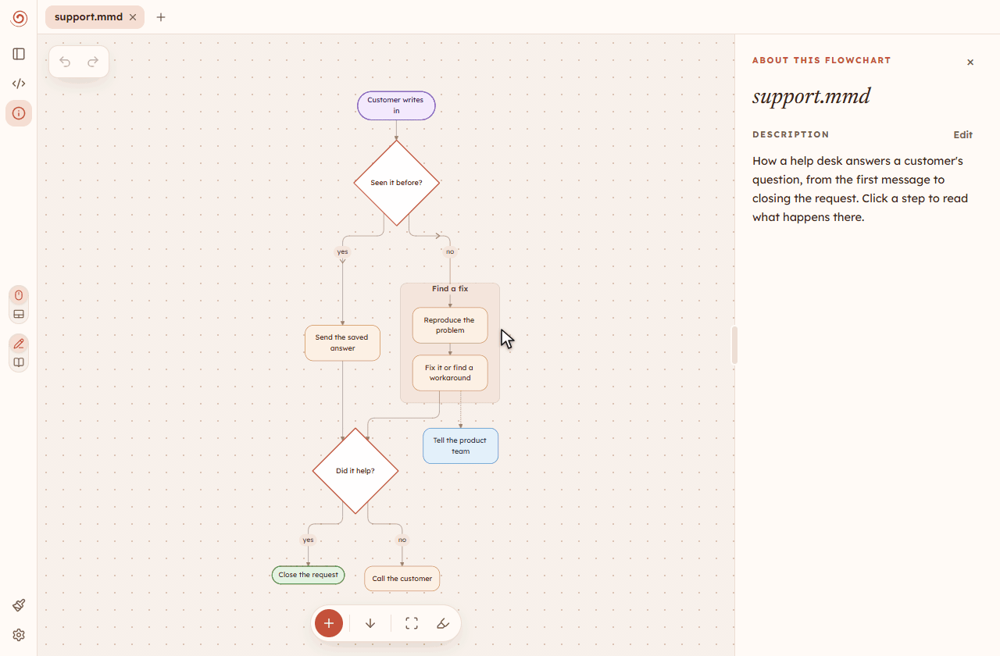
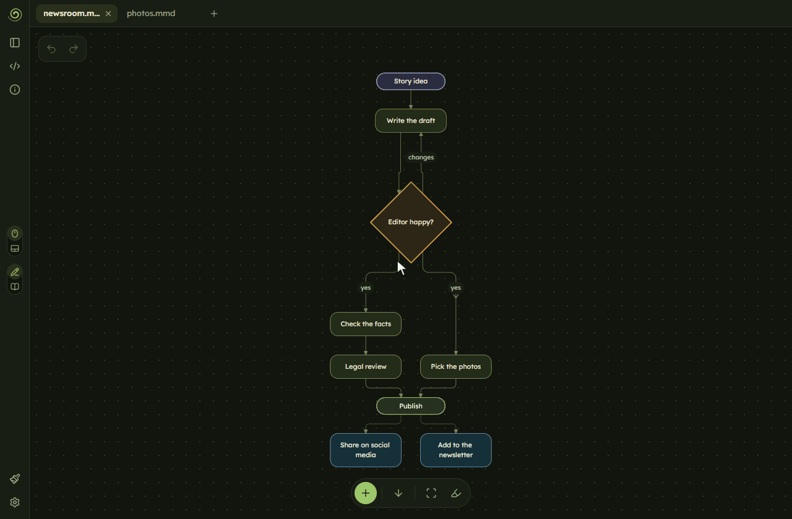

# Naiad

Naiad is a Windows desktop app that views and edits a flowchart kept in one plain
Mermaid text file, for one person and the AI agents that work on the same file.
(Mermaid is a text format for diagrams that many tools, GitHub among them, can draw.)

The chart shows each node's short title. Click a node and the sidebar shows its full
description, which the file keeps beside the node as Mermaid comments. With nothing
selected, the sidebar shows a description of the whole flowchart, kept the same way.
In other Mermaid tools a node shows only its label, so longer detail crowds the chart,
sits in comments the drawn chart never shows, or lives in a second document. With Naiad
the file stays the only copy, opens in any Mermaid tool, and you, an agent or Naiad can
edit it.

Windows 11 (x64) · `.mmd` and `.mermaid` flowcharts · Mermaid places the boxes

[Install](#install) · [Using Naiad](#using-naiad) · [Working with an AI agent](#working-with-an-ai-agent) · [Commands](#commands) · [Limits](#limits)



Reading and editing: a click on a step shows its description in the sidebar; then the
chart is zoomed and scrolled, a step's title and shape are changed, and the Syntax pane
shows the file's text.



Working with an agent: the agent writes a new decision into the file and the chart
redraws at once; then a second file opens beside the first. The orange border and label
mark the time the agent is writing; the recording adds them, and Naiad doesn't show
them.

## How the file works

A node's description is a run of Mermaid comments, lines that start `%%`, under a line
`%% @` followed by the node's id. Mermaid skips comments, so the file draws the same in
any Mermaid tool. Part of the first recording's file:

```text
flowchart TD
    sort{Seen it before?} -- no --> look(Reproduce the problem)

%% @look
%% Follow the customer's steps on a test account until the problem shows.
%% .
%% - Ask for a screenshot if the steps are unclear.
%% - Note the version and the browser.
```

Click **Reproduce the problem** and the sidebar shows the lines under `%% @look` as
Markdown: `%% .` is an empty line, so the two lines that start `-` are a list. A
description that starts `%% @flowchart` describes the whole flowchart.

Naiad reloads the file whenever it changes on disk, so a change an agent makes shows at
once. If you have an edit not yet saved at that moment, the version on disk wins and
your edit stays in Undo. A change made in Naiad rewrites only the lines it needs, and
Mermaid's own parser checks it before it is applied.

A complete file: [examples/sample.mmd](examples/sample.mmd). The full rules, for people
and for agents: [FILE-FORMAT.md](FILE-FORMAT.md).

## Install

1. Open the [latest release](https://github.com/Cleo8731/naiad/releases/latest) and,
   under **Assets**, download the file ending in `_x64-setup.exe`. The two "Source
   code" files are for building Naiad yourself.
2. To check the download (you can skip this), run this in PowerShell in the folder that
   holds it, with the name of the file you downloaded, and compare the hash it prints
   with the SHA-256 shown beside the file on the release page:

   ```powershell
   Get-FileHash .\Naiad_1.0.0_x64-setup.exe
   ```

3. Run the installer. It is not signed, so Windows may show "Windows protected your
   PC": click **More info**, then **Run anyway**.

The installer puts Naiad in `%LOCALAPPDATA%\Naiad` for your Windows user (about 5.7 MB),
without administrator rights. It registers Naiad for `.mmd` and `.mermaid` files, so a
double-click on one opens it, and adds the `naiad` command to your PATH. Then open a
file with **Open a file**, or start one with **New flowchart**.

To update, run a newer release's installer: it installs over the old version. To
uninstall, open Windows **Settings**, then **Apps**, **Installed apps**, and uninstall
Naiad there. Your settings and recent files stay in `%LOCALAPPDATA%\app.naiad.desktop`
unless you tick **Delete the application data** in the uninstaller. To make the
installer yourself, see [Building from source](#building-from-source).

## Using Naiad

The rail is the column of buttons down the window's left edge; the sidebar is on the
right.

| To do this | Do this |
|---|---|
| Open a file | **Open a file** on a blank tab, Ctrl+O there, a double-click on the file, or `naiad flow.mmd`. While Naiad is open, the file opens as a tab in its window |
| Move a tab to a window of its own | Drag the tab out of the window and let go; drag it onto another Naiad window's tabs to move it there |
| Read a description | Click a node; click empty space for the whole flowchart's description |
| Write a description | Click the node, then **Edit** beside **Description** in the sidebar, then **Done** |
| Add a node | **+** in the bar along the bottom of the chart, or double-click empty space |
| Rename a node | Double-click it, or select it and press Enter or F2 |
| Connect two nodes | Point at a node and drag the dot beside it onto another node |
| Change a shape, colour, group or arrow | Click it and use the sidebar |
| Delete | Select, then press Delete |
| Undo / redo | Ctrl+Z / Ctrl+Y, or the curved arrows at the chart's top left |
| Zoom and pan (move the view) | Mouse wheel or pinch to zoom; drag empty space to pan. For two-finger panning on a touchpad, click the first switch in the middle of the rail to Touchpad mode |
| Show an agent which parts you mean | **Highlight** (key H), in the bar along the bottom of the chart, then click them: see [Pointing at parts of the chart](#pointing-at-parts-of-the-chart) |
| Read or edit the Mermaid text | **Syntax** (`</>`), at the top of the rail |
| Read without changing anything | Click the second switch in the middle of the rail to View mode |
| Follow one run through the flowchart, node by node | In View mode, **Walkthrough** (footprints) in the bar along the bottom of the chart; click the node to start from, then the next step at each node |
| Save the chart as a picture | **Export**, under the two switches on the rail: **Save as SVG…** or **Save as PNG…** |
| Print the chart or its descriptions | **Print** (Ctrl+P), under **Export** on the rail |

Naiad saves the file by itself whenever it is a valid flowchart; Ctrl+S saves it at
once. Tabs, windows and split view, the walkthrough's keys, printing over several
pages, the recent files, themes and fonts, settings, pane widths and every other
control: [USING.md](USING.md).

## Working with an AI agent

Any agent that can edit a text file can change a Naiad flowchart. Naiad redraws the
chart whenever the file changes on disk, so you see each change as the agent makes it,
and `naiad check` tells the agent whether its result is a valid Naiad file.

### The skill

The folder [skills/naiad](skills/naiad) is a skill: instructions an agent loads when a
task calls for a flowchart. It teaches the agent the file format, has it check its work
with `naiad check`, and has it show you the result: in the browser beside the
conversation where the agent's tool has one (`naiad serve`), otherwise in Naiad's
window.

To install it, copy the folder `skills/naiad` to the folder where your agent tool reads
skills. For Claude Code, that is one of:

- `~/.claude/skills/naiad`, for every project on your computer;
- `.claude/skills/naiad` inside a project; commit it and everyone working on the
  project has it.

For other agent tools, the [skills](https://github.com/vercel-labs/skills) installer
puts it where they read it. Run it in your project's folder:

```powershell
npx skills add Cleo8731/naiad
```

It puts the skill in the project's `.agents/skills/naiad`, which Codex, OpenCode,
Gemini CLI, GitHub Copilot and many other tools read, and links Claude Code's
`.claude/skills/naiad` to it; `-g` installs it for every project instead. The installer
sends anonymous usage data to its maker, Vercel
([what it sends](https://github.com/vercel-labs/skills/blob/main/docs/troubleshooting.md#telemetry)).
To stop it, run this first in the same PowerShell window:

```powershell
$env:DISABLE_TELEMETRY = '1'
```

Then ask for a flowchart in your own words, for example: "Draw our order process as a
Naiad flowchart in `docs/orders.mmd`, with a description for each step."

### Pointing at parts of the chart

Instead of typing node ids in the chat, click **Highlight** (key H) in the bar along the
bottom of the chart, then click the nodes, arrows or groups you mean. Naiad writes them
to a small file beside the flowchart, `.naiad/<file name>/highlights.txt`, and the agent
reads that file to see which parts you mean. Naiad deletes the file when the last view
of the flowchart closes. The file's format:
[FILE-FORMAT.md](FILE-FORMAT.md#highlights).

### Keeping flowcharts up to date (optional)

A flowchart that describes a project goes stale when the project changes. To have
agents keep it up to date, add this section to the project's instruction file
(`CLAUDE.md`, `AGENTS.md` or its like), with one line for each flowchart:

```markdown
## Naiad flowcharts
Keep these flowcharts up to date: when a change alters what one shows, update it in
the same change, following the naiad skill, and say so in your report.
- `docs/architecture.mmd`: the import pipeline
- `docs/release.mmd`: the release steps
```

The skill offers to add this for you when an agent creates a flowchart of the project.

## Commands

```powershell
naiad flow.mmd          # open the file in Naiad
naiad check flow.mmd    # report where the file breaks the format; no window opens
naiad fix flow.mmd      # make the one safe repair in the file, then check
naiad serve flow.mmd    # show the file in a browser on this computer; prints the address
naiad --version
```

A terminal that was open during the install does not know the command yet: open a new
one.

### `naiad check` and `naiad fix`

`naiad check` is made for agents and scripts: it checks both Mermaid's syntax and
Naiad's description rules, and prints each problem with its line and how to put it
right, or `flow.mmd: no problems`. Its exit code is 0 when there are no problems, 1 when
there are, and 2 when a file could not be checked.

`naiad fix` writes to the file: it turns a line holding only `%%` into `%% .`, then
checks. Details:
[Checking a file from a terminal](FILE-FORMAT.md#checking-a-file-from-a-terminal).

### `naiad serve`

- It is for an agent whose tool has a browser beside the conversation: it shows the
  flowchart there, where you can also edit it, with no separate window.
- It prints an address (`http://127.0.0.1:`, a port and a secret) and returns. Open
  the whole address. Leave it out of bug reports: its secret is what lets a page read
  and change the file.
- The page shows the one file as Naiad's window does, without tabs, split view, the
  recent files or **Settings**. It saves by the same rules, and Naiad's window can be
  open on the same file at the same time.
- The server can be reached from this computer only, answers only at the address it
  printed, refuses requests that come from other web pages, and reads and writes only
  the file it was started for and that file's highlights.
- It ends by itself ten minutes after the page is closed.

## Limits

- Naiad runs on Windows 11 (x64). It has not been tried on Windows 10, and there are no
  macOS or Linux builds.
- It opens Mermaid flowcharts (text that starts `flowchart` or `graph`) in `.mmd` and
  `.mermaid` files. It does not open a Markdown file, even one with a `mermaid` code
  block, or any other kind of Mermaid diagram.
- Mermaid places the boxes. You change titles, descriptions, shapes, colours, groups
  and arrows; a box cannot be dragged to a place of your choosing.
- Some Mermaid forms are drawn but can be changed only as text; the forms the chart can
  change are listed in
  [FILE-FORMAT.md](FILE-FORMAT.md#mermaid-syntax-naiad-can-edit-from-the-chart).
- Version 1.0 has been tested on one Windows 11 computer.

## What Naiad reads and keeps

- Each file you open: read again whenever it changes on disk, and written only as
  [FILE-FORMAT.md](FILE-FORMAT.md#what-naiad-changes-in-a-file-and-what-it-never-does)
  describes.
- Highlights: `.naiad/<file name>/highlights.txt` in the flowchart's folder, with
  Windows' hidden mark on `.naiad`. The file, and the folders it leaves empty, are
  deleted when the last Naiad view of the flowchart closes.
- A picture you export: written only where you save it.
- Its settings, the windows and tabs it reopens and the paths of the last 50 files you
  opened, in the window's own storage in `%LOCALAPPDATA%\app.naiad.desktop`; while it
  runs, small records in your temporary folder. The full list:
  [USING.md](USING.md#what-naiad-keeps-on-your-computer).
- Naiad makes no network requests of its own. An image in a description that points to
  a web address is loaded from there when the description is shown, and a link in a
  description opens in your browser.

## Building from source

Made and tested on Windows 11 with Node.js 26.7 (npm 11.19), Rust 1.99.1
(`stable-x86_64-pc-windows-msvc`) and the Visual Studio 2022 C++ Build Tools (see the
[Tauri prerequisites](https://tauri.app/start/prerequisites/)).

```bash
git clone https://github.com/Cleo8731/naiad.git
cd naiad
npm install
npm test               # run the tests
npm run dev            # Naiad in a browser, without the desktop window
npm run tauri build    # the desktop app and its installer, in src-tauri/target/release/
```

`npm run dev` opens `examples/sample.mmd`, or the file named by the `NAIAD_FILE`
environment variable, and saves changes to it. No continuous integration (CI) service
runs the tests on each push; run `npm test` before sending a change.

## Feedback and credits

Report a problem or ask for a change in the
[issues](https://github.com/Cleo8731/naiad/issues).

Built with [Tauri](https://tauri.app) and [Mermaid](https://mermaid.js.org).

## Licence

[MIT](LICENSE). The bundled fonts, Lexend, Newsreader, JetBrains Mono, DM Mono and
Recursive, are under the [SIL Open Font License 1.1](src/fonts/OFL.txt). The window's
icons are from [Lucide](https://lucide.dev), under the ISC License, and those Lucide
took from Feather under the MIT License; both are in [src/icons/LICENSE](src/icons/LICENSE).
