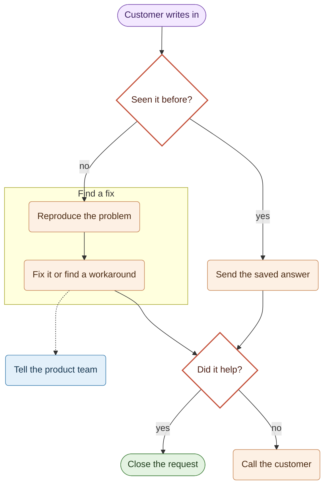

# Naiad

Naiad is a Windows desktop app that shows and changes a flowchart kept in one plain
Mermaid text file, for one person and the AI agents that work on the same file.

The chart shows each node's short title. Click a node and the sidebar shows its full
description, which the file keeps beside the node as Mermaid comments. With nothing
selected, the sidebar shows a description of the whole flowchart, kept the same way. In other Mermaid
tools a node holds only its label, so detail either crowds the chart or lives in a
second document. With Naiad the file stays the only copy, opens in any Mermaid tool, and
you, an agent or Naiad can change it.


The flowcharts in the recordings are made up. In the second, a script stands in for
the agent: it adds the decision "Cleared?" and the step "Hold the story" by writing to
`newsroom.mmd` while Naiad is open. Both were recorded in the browser version
(`npm run dev`), which has the desktop window's contents without its minimize,
maximize and close buttons.

Here is the first recording's file before the rename, with one of its nine step
descriptions. GitHub draws the chart; the lines starting `%%` are descriptions, which
Mermaid leaves out and Naiad shows in the sidebar. A description is Markdown, and `%% .`
is an empty line in it:



- The flowchart is one `.mmd` or `.mermaid` file.
- Naiad reloads the file whenever it changes on disk, so a change an agent makes shows
  at once.
- A change made in Naiad rewrites only the lines it needs, and Mermaid's own parser
  checks it before it is applied.

A description is a run of Mermaid comments that starts with `%% @` and the node's id;
the whole flowchart's description starts with `%% @flowchart`.
The full rules, for people and for agents: [FILE-FORMAT.md](FILE-FORMAT.md).

## Install

Download the installer, the file ending in `_x64-setup.exe`, from the
[latest release](https://github.com/Cleo8731/naiad/releases/latest) and run it. For
version 0.3.13 it is `Naiad_0.3.13_x64-setup.exe`, 3.3 MB; the release page gives its
SHA-256 checksum. The installer is not signed, so Windows may show "Windows protected
your PC": click **More info**, then **Run anyway**.

It installs Naiad for your Windows user in `%LOCALAPPDATA%\Naiad` (about 5.9 MB),
without administrator rights. It registers Naiad for `.mmd` and `.mermaid` files, so a
double-click on a `.mmd` file opens it, and adds the `naiad` command to your PATH. Then
open a file with **Open a file**, or start one with **New flowchart**.

To make the installer yourself instead, see [Building from source](#building-from-source).

## Using it

The tabs run across the top of the window, with the window's own minimize, maximize
and close buttons at their right end; drag the empty part of that row to move the
window, or double-click it to maximize the window. Down the window's left edge, the
rail holds **Recent files**, **Syntax** and **About** at the top, two switches in the
middle (Mouse or Touchpad, and Edit or View), and **Customize** and **Settings** at
the foot; pointing at a button shows its name, and pointing at a switch shows both of
its modes' names, the one in use under the knob. On the chart, Undo and Redo sit at the top left, and a bar at the
foot holds **+** (add a node), the direction button, **Fit** and **Highlight**.

| To | Do |
|---|---|
| Open several flowcharts | Each file opens in its own tab. The **+** at the end of the tabs opens a blank tab, which shows **Open a file** and **New flowchart** (Ctrl+O opens a file there too). A tab that holds a file is never replaced by another file. With many tabs open, the tabs grow narrower; past that, the mouse wheel scrolls them, and a button after them, showing how many are out of sight, lists every tab. A tab's × closes it at once, and asks first only when text not yet saved would be lost. Each tab keeps its own Undo history, selection and zoom; View mode, **Highlight** and Touchpad or Mouse mode apply to every tab. A page from `naiad serve` shows one file and has no tabs |
| See two flowcharts at once | Drag a tab onto the chart, toward the side where it should open: that half lights up and names the tab, and letting go splits the window, side by side or one above the other. Each half has its own row of tabs, with its own **+** and list of every tab; a click on a tab shows it in its own half. Drag a tab onto the other half, or into the other row of tabs, to move it there. The half you last clicked is the active one: it has an accent line along its top, and the sidebar, Undo and the keys work on it. Drag the line between the halves to resize them (each at least 240 pixels across); double-click it for half and half. The **×** at the end of a row of tabs closes the split and moves its tabs to the other row; closing a half's last tab closes it too. A page from `naiad serve` has no split |
| Open a file you opened before | The **Recent files** button, a panel, at the top of the rail, shows the last 50 files you opened, newest first, in a pane beside the rail: 25 at first, and 25 more with each click on **View more**. Click one to open it: in the shown tab when that tab is blank, otherwise in a new tab after it; a file already open shows its tab. × takes it off the list and leaves the file where it is. A file that is no longer there stays on the list, greyed and marked "Not found", until you take it off. The list opens by itself on a blank tab and closes when a file opens; between two files' tabs it stays as you left it. The list and the Mermaid syntax are never shown together: opening the list closes the syntax, which stays closed until you open it again. A page from `naiad serve` has no list |
| Choose light or dark, the colours and the Syntax pane's font | **Customize**, a brush at the foot of the rail, opens a window with three choices. **Appearance**: **Light**, **Dark** or **System**; System, the choice until you pick another, follows the light or dark setting of your computer. **Theme**: one of six sets of colours, each with a light and a dark form: Naiad Default (the choice until you pick another), Moonpool, Kelp, Water Lily, Glacier and Coral; the chart takes its colours too. **Syntax font**: JetBrains Mono (the choice until you pick another), DM Mono or Recursive Casual, each shown on a line of a flowchart. The window closes with its ×, Escape, or a click outside it. Naiad remembers each choice |
| Have your files open again when Naiad starts | **Settings**, a gear under **Customize**, opens a window with the switch **Remember opened files**, on until you turn it off. While it is on, Naiad opens again the files that were open when it last closed, each in its tab and in the same order, and shows the tab that was shown. A file that is no longer there is skipped, and a notice names it. A file you start Naiad on, with a double-click or `naiad flow.mmd`, opens after them and is shown. A second window, opened while another Naiad window is open, opens only its own file; of two windows, the one closed last is remembered. Turning the switch off forgets the list at once. A page from `naiad serve` has no Settings |
| Read a description | Click a node |
| Read or write what the whole flowchart is about | Click empty space: the sidebar shows the flowchart's description, under any node, arrow or group you select. **About**, on the rail, hides or shows it, and Naiad remembers your choice |
| Make a pane wider or narrower | Drag the grip on the pane's edge that faces the chart. The recent files pane is 180 to 420 px wide (232 at first), the Syntax pane 220 to 640 px (330), and the sidebar 280 to 560 px (340). Naiad remembers each width |
| Add a node | **+** in the bar at the chart's foot, or double-click empty space |
| Rename | Double-click a node, or press Enter / F2 |
| Connect two nodes | Point at a node and drag the dot beside it to another node, or Shift-click the second node |
| Change an arrow | Click it: label, line, head, colour |
| See where a node's arrows go | Rest the pointer on the node: its arrows and the nodes at their other ends stay, and the rest fades |
| See which way a long arrow goes | Look along it: an arrow at least 250 px long at 100% zoom, with a head at one end only, carries a small arrowhead about every 150 px, pointing the way it goes |
| Move an arrow's start or end | Point at the arrow and drag the dot at that end onto another node or group; or pick it under **From** or **To** in the sidebar |
| Group nodes | Click a node and pick **New group…** under **Group** in the sidebar; then click each other node and pick that group there |
| Delete | Select, then Delete |
| Undo / redo | Ctrl+Z / Ctrl+Y, or the curved arrows at the chart's top left |
| Change which way the chart runs | The direction button, an arrow, shows the way the chart runs now. Point at it or click it to show the other three ways, and click one: the file's first line changes, for example from `flowchart TD` to `flowchart LR` |
| Zoom / pan | Mouse wheel or pinch to zoom; drag empty space to pan |
| Move the chart with two fingers on a touchpad | The first switch in the middle of the rail shows a mouse over a touchpad, with a knob on the mode in use. Click it to slide the knob to the touchpad: in Touchpad mode two fingers or the mouse wheel move the chart (Shift: sideways), and a pinch or Ctrl with the wheel zooms. Naiad starts in Mouse mode and remembers your choice |
| Point at nodes, arrows or groups with an agent | The **Highlight** button, a highlighter pen (key H), then click them; **Clear**, at the chart's top left with the number of highlights, takes every highlight off |
| Show or hide the flowchart's Mermaid syntax | The **Syntax** button, `</>`, on the rail (the syntax is hidden when Naiad starts, unless you left it open). Opening it closes the **Recent files** list. The pane colours the parts of each line (ids, titles, arrows, labels, classes and descriptions) and numbers the lines; a long line wraps, and a bar beside the numbers marks its wrapped rows |
| Read or edit the syntax with the whole window | The button at the Syntax pane's top right makes the pane fill the window, over the chart and the sidebar. Click it again, or hide the pane, to see the chart again |
| Read without changing anything | The second switch in the middle of the rail shows a pencil (Edit mode) over an open book (View mode), with a knob on the mode Naiad is in. Click it to switch. View mode has no dots to drag, no dot grid, no **+**, direction button, Undo or Redo, and the sidebar and the Syntax pane show text only; an edit tried there shows a notice instead. Naiad opens in the mode you left it in |

While you drag a dot, holding the pointer within 48 px of the chart's edge moves the
view that way, at up to 1,200 px a second, until the chart's edge on that side comes
into view; the wheel and a pinch work as they do outside a drag, and Escape cancels the
drag.

The file is saved by itself while it is a valid flowchart; Ctrl+S saves it at once.
Naiad shows no "Saved" mark. A notice at the top of the chart says when the file could
not be saved or read, and when its text is not a flowchart Mermaid can read. Text like
that, typed in Naiad, is saved only when you press Ctrl+S.
Highlights are kept in a small file of their own beside the flowchart, which an agent
reads and writes too ([FILE-FORMAT.md](FILE-FORMAT.md#highlights)).

## From a terminal

```bash
naiad flow.mmd          # open the file in Naiad
naiad check flow.mmd    # report where the file breaks the format; no window opens
naiad fix flow.mmd      # put right what cannot change the flowchart, then check
naiad serve flow.mmd    # show the file in a browser on this computer; prints the address
naiad --version
```

A terminal that was open during the install does not know the command yet: open a new
one.

`naiad check` is made for agents and scripts: it prints each problem with its line and
how to put it right, or `flow.mmd: no problems`. Its exit code is 0 when there are no
problems, 1 when there are, and 2 when a file could not be checked. Details:
[FILE-FORMAT.md](FILE-FORMAT.md), "Checking a file from a terminal".

`naiad serve` is for an agent whose tool has a browser beside the conversation: it
shows the flowchart there, where you can also change it, with no separate window. The
command prints an address (`http://127.0.0.1:` and a port) and returns. The page at
that address is Naiad itself and saves by the same rules; Naiad's own window can be
open on the same file at the same time. The server behind it can be reached from this
computer only, answers only at the address it printed (which holds a secret), refuses
requests that come from other web pages, reads and writes only the file it was started
for and that file's highlights, and ends by itself ten minutes after the page is closed.

## For AI agents

The folder [skills/naiad](skills/naiad) is a skill: instructions an agent loads when a
task calls for a flowchart. It teaches the agent the file format, has it check its work
with `naiad check`, and has it show you the result: in the browser beside the
conversation where the agent's tool has one, otherwise in Naiad's window.

The [skills](https://github.com/vercel-labs/skills) installer knows where each agent
tool keeps its skills. This command has not been tried with Naiad's skill yet:

```bash
npx skills add Cleo8731/naiad
```

Or copy the folder `skills/naiad` by hand: for Claude Code, to `~/.claude/skills/naiad`
(every project on your computer) or to `.claude/skills/naiad` inside a project (commit
it and everyone working on the project has it).

### Keeping flowcharts up to date (optional)

A flowchart that describes a project goes stale when the project changes. To have
agents keep it true, add this section to the project's instruction file (`CLAUDE.md`,
`AGENTS.md` or its like), with one line for each flowchart:

```
## Naiad flowcharts
Keep these flowcharts true: when a change alters what one shows, update it in
the same change, following the naiad skill, and say so in your report.
- `docs/architecture.mmd`: the import pipeline
- `docs/release.mmd`: the release steps
```

The skill offers to add this for you when an agent creates a flowchart of the project.

## What Naiad reads and keeps

- Each file you open: read again whenever it changes on disk, and written only as
  [FILE-FORMAT.md](FILE-FORMAT.md#what-naiad-changes-in-a-file-and-what-it-never-does)
  describes.
- Highlights: `.naiad/<file name>/highlights.txt` in the flowchart's folder, with
  Windows' hidden mark on `.naiad`. The file, and the folders it leaves empty, are
  deleted when the last Naiad view of the flowchart closes.
- In your temporary folder, while they run: a small record of each open window
  (`naiad-views`), and the address of each `naiad serve` server (`naiad-serve`), so a
  second `naiad serve` on the same file prints the same address.
- Whether the Syntax pane is shown, the width of each pane, whether View mode and
  **About** are on, Touchpad or Mouse mode once you choose one, the appearance, theme
  and Syntax font once you choose them, and whether **Remember opened files** is on once
  you turn it off or on, in the window's own storage.
- While **Remember opened files** is on, the full paths of the files open in the tabs,
  in their order, and which one is shown; while the window is split, also which tabs
  are in the second half, the tab each half shows, and the split's direction and
  divider. They are in the same storage (`src/app.ts`), written each time a tab opens,
  closes or is shown, and when the window closes.
- The full paths of the last 50 files you opened, for the recent files, in the same
  storage (`src/recent.ts`). While the list is shown, Naiad checks that each listed
  file is still there; it reads none of them until you click one.
- Naiad makes no network requests of its own. An image in a description that points to
  a web address is loaded from there when the description is shown, and a link in a
  description opens in your browser.

## Limits

- Naiad 0.3.13 has been made and tested on Windows 11 (x64) only. There are no macOS or
  Linux builds.
- It works on Mermaid flowcharts only (text that starts `flowchart` or `graph`), in
  `.mmd` and `.mermaid` files. It does not open a Markdown file (`.md`), even one with a
  `mermaid` code block.
- Some Mermaid forms are drawn but can be changed only as text; the forms the chart
  can change are listed in
  [FILE-FORMAT.md](FILE-FORMAT.md#mermaid-syntax-naiad-can-edit-from-the-chart).
- Mermaid places the boxes. The file keeps no positions, so a node cannot be moved by
  hand.
- A double-click on a `.mmd` file while Naiad is open opens a second window, not a tab
  in the open one.

## Building from source

Made and tested on Windows 11 with Node.js 26.7 (npm 11.19), Rust 1.99.1
(`stable-x86_64-pc-windows-msvc`) and the Visual Studio 2022 C++ Build Tools (see the
[Tauri prerequisites](https://tauri.app/start/prerequisites/)).

```bash
npm install
npm test               # run the tests
npm run dev            # Naiad in a browser, without the desktop window
npm run tauri build    # the desktop app and its installer, in src-tauri/target/release/
```

`npm run dev` opens `examples/sample.mmd`, or the file named by the `NAIAD_FILE`
environment variable, and saves changes to it.

Report a problem or ask for a change in the
[issues](https://github.com/Cleo8731/naiad/issues).

Built with [Tauri](https://tauri.app) and [Mermaid](https://mermaid.js.org).

## Licence

[MIT](LICENSE). The bundled fonts, Lexend, Newsreader, JetBrains Mono, DM Mono and
Recursive, are under the [SIL Open Font License 1.1](src/fonts/OFL.txt). The window's icons are from
[Lucide](https://lucide.dev), under the [ISC License](src/icons/LICENSE).
