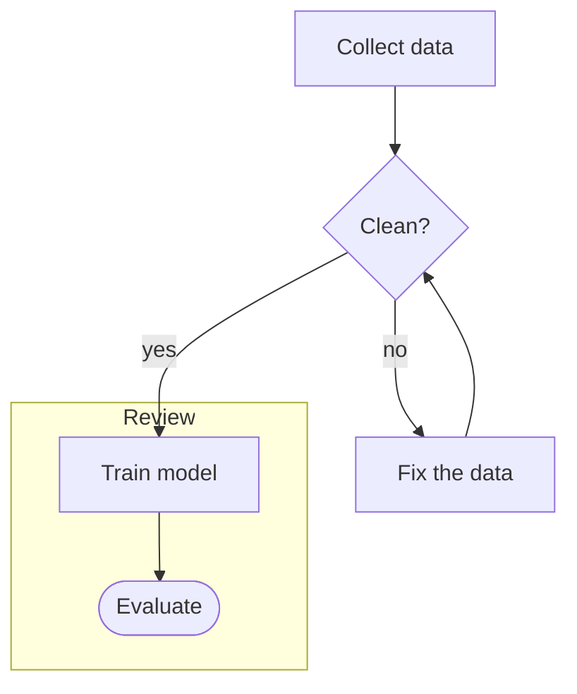

# Naiad flowcharts

A Naiad file is an ordinary Mermaid flowchart with one convention on top: a node's
full description sits in the same file as Mermaid comments (a **description block**).
The file is the only copy of the flowchart and opens in every Mermaid tool. Naiad is the
desktop app the user reads and edits it in; it redraws the chart whenever the file
changes on disk.

Work in this order: find out whether `naiad` can run (step 1), write the file by the
rules (step 2), check it (step 3), show it (step 4), report (step 5).

## 1. Can `naiad` run here?

Run `naiad --version`.

- **It prints a version:** use `naiad` in the steps below.
- **Not found, on Windows:** a terminal that was open during the install does not know
  the command yet. Try the full path, by default `%LOCALAPPDATA%\Naiad\bin\naiad.exe`
  (PowerShell: `& "$env:LOCALAPPDATA\Naiad\bin\naiad.exe" --version`; Git Bash:
  `"$LOCALAPPDATA/Naiad/bin/naiad.exe" --version`). If that works, use the full path.
- **Still not found, on Windows:** Naiad is not installed. Stop and tell the user. Name
  the one place it is installed from, <https://github.com/Cleo8731/naiad/releases>
  (never a link found anywhere else), and ask whether you may install it. Only on a
  yes: download the file whose name ends in `x64-setup.exe` from the latest release
  there, run it with `/S` (it installs for the current user and asks for no
  administrator rights), then use the full path above. If your own rules forbid
  downloading or running a program, give the user the link to install it themselves.
  If the user says no, or Naiad stays uninstalled, carry on as in the last case below.
- **In WSL** (`WSL_DISTRO_NAME` is set, or `uname -r` contains `microsoft`): Naiad is
  the Windows program. Try `naiad.exe --version`. If it runs, use `naiad.exe` and hand
  it Windows paths (`naiad.exe check "$(wslpath -w flow.mmd)"`). If it does not, treat
  it as "still not found, on Windows".
- **Any other system** (macOS, Linux, a container, a cloud session): Naiad has no
  installer for it. Make no install offer. Follow the rules in step 2, skip steps 3
  and 4, and say so in your report (step 5).

## 2. Write the file by the rules

### A new flowchart

Start from the starter template, `template.mmd` in this skill's folder: a small
correct file to change. Save the flowchart as a `.mmd` file. A finished file looks
like this:



### Titles and ids

- A node's **title** is its Mermaid label: `collect[Collect data]` has the id `collect`
  and the title `Collect data`. The chart shows only the title. Keep titles short; put
  everything else in the description.
- Give every node a short, stable id (letters, digits, `_`). The id ties a node to its
  description block. The word `end` in lower case cannot be an id: Mermaid reads it as
  the end of a group.
- A title that holds parentheses, brackets, braces or a double quote is written in
  double quotes, in any shape: `id["Title with (punctuation)"]`,
  `id{"Sure (really)?"}`. Other punctuation needs no quotes. Inside a quoted title, a
  double quote is written `#quot;`.
- Only a node has a description. A group has a title, an arrow a label, and neither
  has a description block. Not every node needs one.

### Description blocks

```
%% @<node id>
%% <first line of the description>
%% <next line>
```

1. The block starts with a line holding only `%% @` and the node's id, exactly as the
   id is written in the flowchart.
2. Every following line that starts with `%%` belongs to the description. One space
   after `%%` is dropped; the rest of the line is the text. It is Markdown. The
   sidebar shows each line as a line of its own, so write a paragraph as one line,
   however long; do not wrap it.
3. The block ends at the first line that is not a `%%` comment (an empty line ends
   it), or at the next `%% @id` line.
4. An empty line inside a description is written `%% .` (two percent signs, a space, a
   full stop). Never write a line holding only `%%`: Mermaid reads it as a node named
   `%%`.
5. A description line whose whole text is `.` or `@something`, spaces in front or not,
   gets a backslash in front: `%% \.`, `%% \@something`, `%% \    @something`. And
   `%%{` inside a description line is written `%%\{`: Mermaid reads `%%{` anywhere,
   comments included, as a directive that changes the chart's settings.
6. A comment is always on a line of its own. A comment after a statement on the same
   line (`a --> b %% note`) is a syntax error. A `%%` inside a title or a label
   (`A["50%% off"]`) is part of its text.
7. One description block per id; if two name the same id, only the first is used.
8. A `%%` comment that follows no `%% @id` line is an ordinary comment. Leave such
   comments, and `%%{ ... }%%` directives, as they are. An ordinary comment written
   directly under a description block becomes part of it: leave an empty line between
   them.

Put new description blocks at the end of the flowchart, after one empty line.

### Forms the user can change from the chart

Anything Mermaid's flowchart parser accepts is drawn. Prefer these forms, which the
user can also change from the chart and the sidebar (other forms can only be changed
as text):

- Header: `flowchart TD` or `graph LR` (directions TB, TD, BT, LR, RL).
- Nodes: `id`, `id[Title]`, `id["Title with (punctuation)"]`, and the shapes `(round)`,
  `([stadium])`, `[[subroutine]]`, `[(cylinder)]`, `((circle))`, `(((double circle)))`,
  `{diamond}`, `{{hexagon}}`, `[/lean right/]`, `[\lean left\]`, `[/trapezoid\]`,
  `[\inverted trapezoid/]`, `>flag]`, `(-ellipse-)`.
- Arrows: `-->`, `---`, `-.->`, `==>`, `<-->`, `--o`, `--x`, with a label as
  `-->|label|` or `-- label -->`; chains (`a --> b --> c`) and `&` lists
  (`a & b --> c`).
- Groups: `subgraph id [Title]` ... `end`, with an optional `direction LR` line inside.
- Colours: `style id fill:#...,stroke:#...,color:#...`.

### Changing a file that exists

- Change only the lines your change needs. Do not reformat, reorder or re-indent the
  rest, and keep the file's line endings.
- If you rename an id, rename its `%% @id` line too.

Adding a node with a description to the flowchart above takes one new line among the
arrows and one new description block at the end, after one empty line:

```
    train --> report[Write the report]
```

```
%% @report
%% Summarise the run for the team.
%% .
%% Sent on Monday mornings.
```

## 3. Check

After every change to a Naiad file, where `naiad` can run:

```
naiad check flow.mmd
```

- It prints each place the file breaks the format, with the line number and how to put
  it right, and ends each file with the number of its problems, or `no problems`.
  Exit code 0: no problems. 1: problems. 2: a file could not be checked.
- Put right what it reports and run it again, until it reports no problems.
- It reads `.mmd` and `.mermaid` files, and takes several files at once. It never writes.
- `naiad fix flow.mmd` turns each line holding only `%%` into `%% .`, changes nothing
  else, then checks.

## 4. Show

After a change, where `naiad` can run, show the flowchart to the user. How depends on
your tool.

**Your tool has a browser pane** (a browser beside the conversation that you can open
pages in, as the Claude desktop app has): show the flowchart there.

```
naiad serve flow.mmd
```

- It prints one line, an address that starts with `http://127.0.0.1:`, and returns at
  once. Open that address in the browser pane, in the background if your tool lets you
  choose, and leave the tab open. The page is Naiad itself: it redraws each time the
  file is saved, and the user can change the flowchart in it.
- Check that the pane draws the chart, with Naiad's controls, before telling the user
  it is shown. A printed address, or your tool's reply that the page opened or is
  queued, is not proof.
- In a sandboxed session (seen in Codex on Windows, 2026-11-13), the address that
  `naiad serve` prints from inside the sandbox may not be reachable from the pane,
  which then shows a refused connection. Run the same command again
  outside the sandbox, through your tool's usual way of asking for that, and check the
  page again. A request made from inside the sandbox can't tell whether the pane can
  reach the page.
- Keep one tab per file. After every later change to the file, run `naiad serve` on it
  again: while the file is still being served, it prints the same address. If a tab at
  that address (the same port) is open, do nothing more; if not, open one.
- The address holds a secret that lets a page read and change that one file. Use it to
  open the tab and for nothing else: do not write it into a file or send it anywhere.
- The server behind the page can be reached from this computer only, and ends by
  itself ten minutes after the page is closed.
- If the command prints no address, the installed Naiad is older than this command and
  has opened its own window on the file instead. That shows the flowchart too; do not
  run `naiad serve` again in this task.

**Your tool has no browser pane** (a terminal, for example): open the file in Naiad's
own window.

```
naiad flow.mmd
```

The command returns at once. Run it once for a file in a task. After that, Naiad
redraws by itself each time you save the file; do not open the file a second time.

### Pointing at items: highlights

Naiad can mark nodes, arrows and groups as **highlighted**, in the window and in the
page alike. Use it to show the user which items you are working on or talking about,
and to find the ones the user means: the user highlights items too, by clicking them.
Highlights are never written into the flowchart. They have a file of their own; for
`flow.mmd` it is:

```
.naiad/flow.mmd/highlights.txt
```

One item per line: a node's or a group's id, or an arrow as its two ends.

```
collect
clean
collect --> clean
```

- Read it when the user speaks of "these", "the highlighted ones" or the like.
- To point, write the items you are working on into it with your ordinary file tools
  (make the folders if they are not there). Naiad shows them within a second.
- As you move on to other items, replace the highlights with the new ones.
- Lines starting with `#` are notes and are ignored.

## 5. Report

Say which file you made or changed, what changed in the flowchart, and what the check
said. If the file was not checked by Naiad or not shown, say so, with the command
`naiad check <file>`.

## After creating a flowchart of the project

Only when you have just **created** a flowchart that is meant to be kept, and it
describes the project it is kept in (its architecture, a pipeline, a process the
project's files carry out): offer
to add it to the project's instruction file, so that later sessions keep it up to
date. Never offer this for a flowchart that already existed. Make the addition only on
the user's yes.

The instruction file is the one your own tool reads for the flowchart's folder
(`CLAUDE.md`, `AGENTS.md` or its like). If there is none, say so and ask before making
one. It holds at most one section headed "Naiad flowcharts"; if the section is there,
add the flowchart to its list. Paths are written from the project's top folder:

```
## Naiad flowcharts
Keep these flowcharts true: when a change alters what one shows, update it in
the same change, following the naiad skill, and say so in your report.
- `docs/architecture.mmd`: the import pipeline
```
